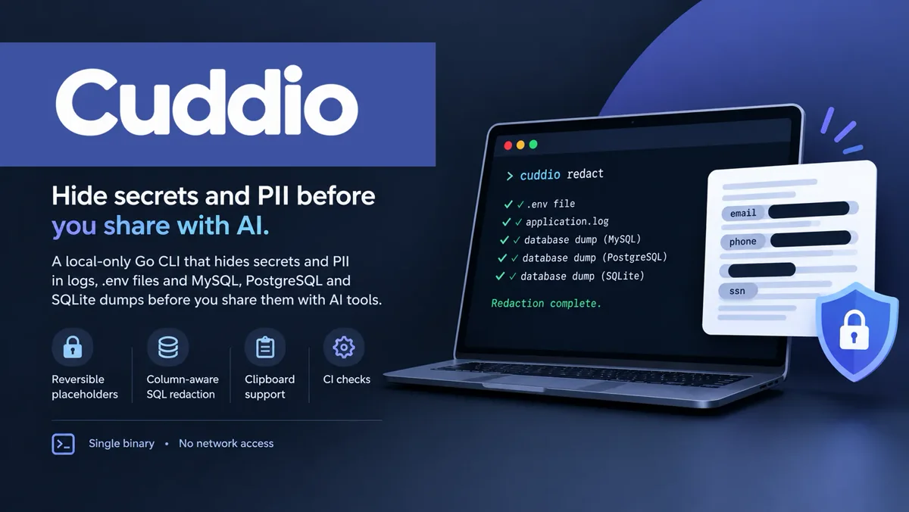
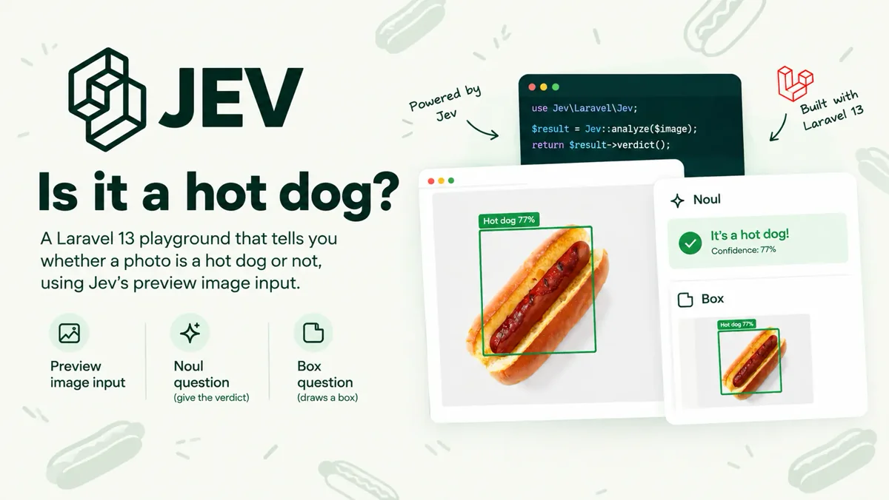
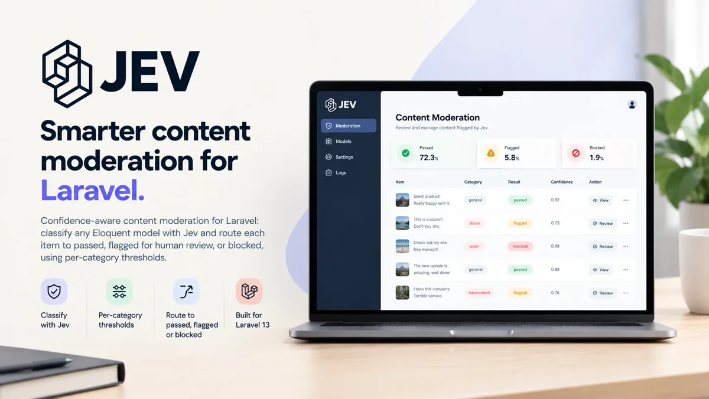
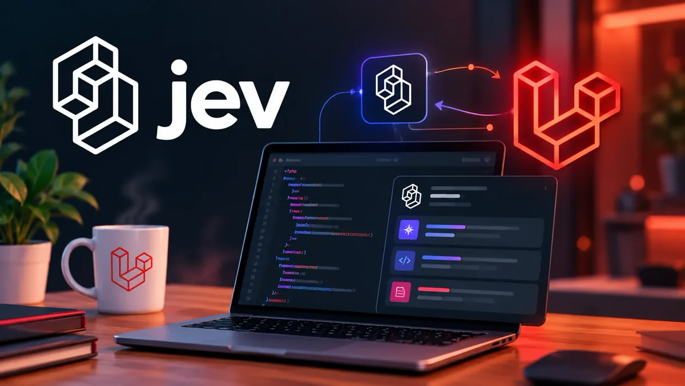
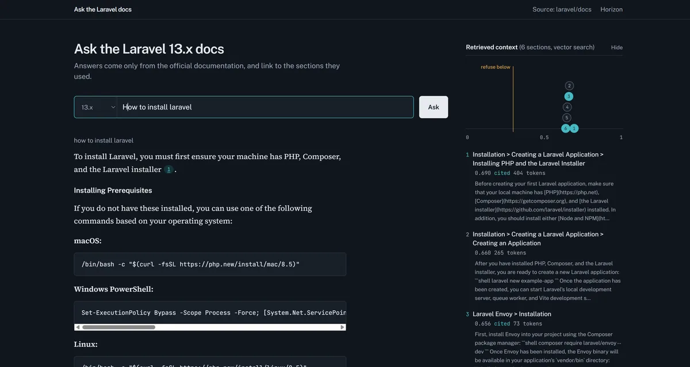
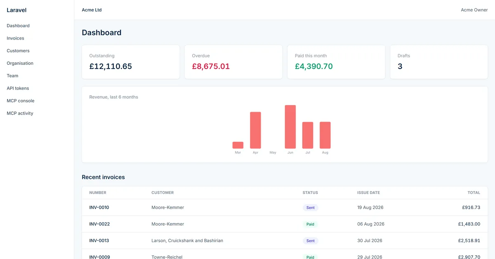
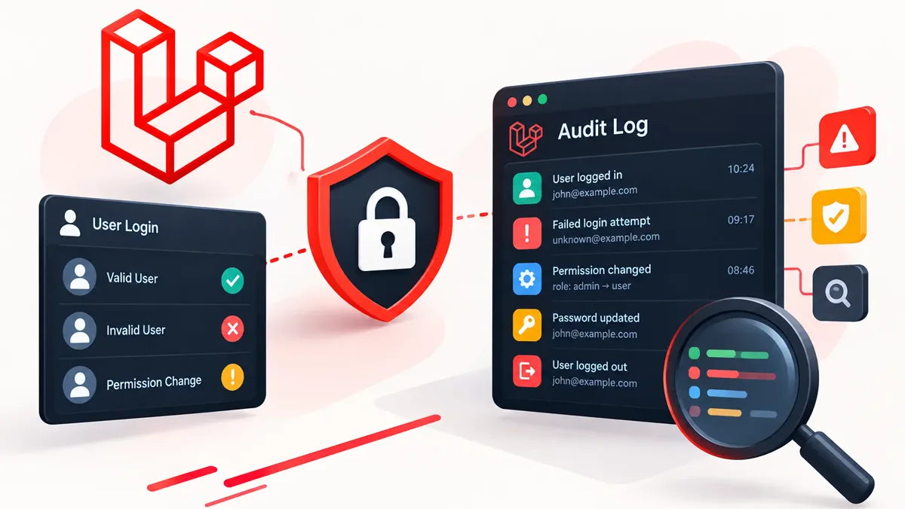
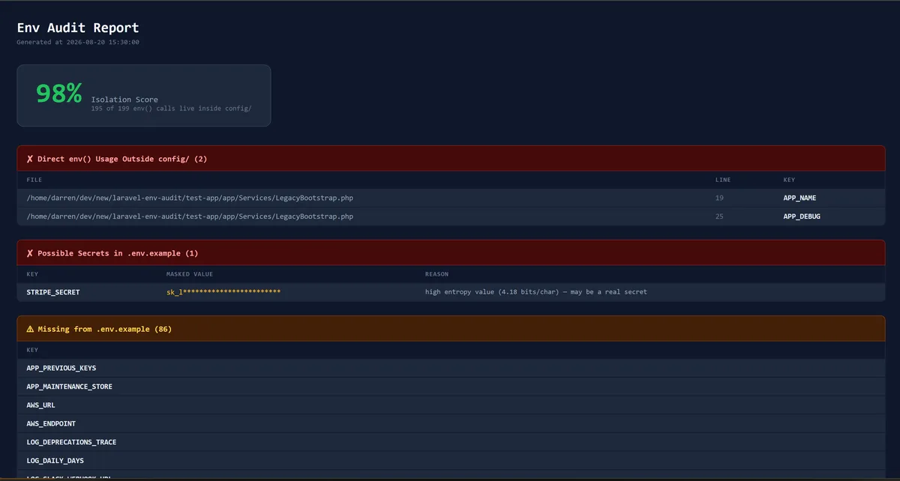

### Croeso, I'm Darren 👋

Senior PHP developer (Laravel and Symfony), AWS Certified Developer, Newport, South Wales. Lately I've been building production AI features in Laravel: measuring them, guarding them and keeping them honest.

#### 🛠️ What I've been building

<table>
<tr>
<td width="33%" valign="top">
 

<b><a href="https://github.com/phoenix1331/cuddio">Cuddio</a></b> 
A local-only Go CLI that hides secrets and PII in logs, <code>.env</code> files and MySQL, PostgreSQL and SQLite dumps before you share them with AI tools. Reversible placeholders, column-aware SQL redaction and CI checks. Single binary, no network access.

</td>
<td width="33%" valign="top">
 

<b><a href="https://github.com/phoenix1331/laravel-jev-hotdog">Jev hot dog</a></b> 
Tells you whether a photo is a hot dog using Jev's image input: a Noul question gives the verdict and a Box question draws a box round it. Runs in fake mode straight after cloning.

</td>
<td width="33%" valign="top">
 

<b><a href="https://github.com/phoenix1331/laravel-ai-headroom">Headroom</a></b> 
Counts an agent's whole request before it is sent and blocks it if it would go over the context window or your budget.

</td>
</tr>
<tr>
<td width="33%" valign="top">
 

<b><a href="https://github.com/phoenix1331/laravel-jev-moderation">Jev Moderation</a></b> 
Classifies any Eloquent model with Jev and routes each item to passed, flagged for human review, or blocked, using per-category thresholds. A <a href="https://github.com/phoenix1331/filament-jev-moderation">Filament review queue</a> shows whether those thresholds match what your moderators decide.

</td>
<td width="33%" valign="top">
 

<b><a href="https://github.com/phoenix1331/laravel-jev-exam-marking">Jev exam marking</a></b> 
A decision model marks the answers, code applies the rules, and a human makes the final call. No prose to parse.

</td>
<td width="33%" valign="top">
 

<b><a href="https://github.com/phoenix1331/laravel-docs-rag-playground">Laravel Docs RAG</a></b> 
Cited answers from the Laravel docs, built step by step with pgvector and scored by a retrieval eval.

</td>
</tr>
<tr>
<td width="33%" valign="top">
 

<b><a href="https://github.com/phoenix1331/laravel-mcp-invoicing-playground">MCP invoicing</a></b> 
Everything a person can do in the browser is also an MCP tool for an AI client, with the same policies and audit trail. A parity test fails CI if the two ever drift apart.

</td>
<td width="33%" valign="top">
 

<b><a href="https://github.com/phoenix1331/laravel-auth-audit">Auth Audit</a></b> 
Scans routes, controllers, Form Requests and Policies to find endpoints that check who you are but not what you may access (IDOR). Fails CI when coverage drops. Built after finding a cross-tenant data leak in a pre-launch security review.

</td>
<td width="33%" valign="top">
 

<b><a href="https://github.com/phoenix1331/laravel-env-audit">Env Audit</a></b> 
Catches <code>env()</code> calls outside <code>config/</code> that break silently after <code>config:cache</code>, drift from <code>.env.example</code>, and likely secrets committed to it.

</td>
</tr>
</table>

